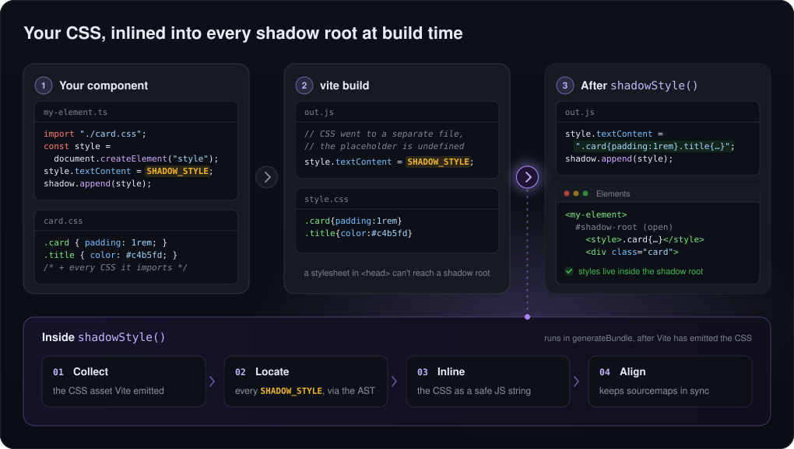

# vite-plugin-shadow-style

<p align="center">
  
</p>

## What it does
This plugin allows you to inject css styles into the shadow root of your web
components.

<p align="center">
  
</p>


## How to install
Just run a simple
```sh
npm i -D vite-plugin-shadow-style
```


## How to use it
Declare your entry point like this:

```tsx
export function defineEntry() {
  class MyComponentEntry extends HTMLElement {
    public static Name = "my-component";
    private mountPoint!: HTMLDivElement;

    constructor() {
      super();
    }

    connectedCallback() {
      this.mountPoint = document.createElement("div");

      // This is the important part, where you're creating a style tag to
      // inject into the shadow root.
      const style = document.createElement("style");
      style.innerHTML = SHADOW_STYLE;

      const shadowRoot = this.attachShadow({ mode: "open" });

      shadowRoot.appendChild(this.mountPoint);
      shadowRoot.appendChild(style);

      ReactDOM.createRoot(this.mountPoint).render(<MandGBreakdown />);
    }
  }

  window.customElements.get(MyComponentEntry.Name) ||
    window.customElements.define(MyComponentEntry.Name, MyComponentEntry);
}

defineEntry();
```


At this point, you'll probably get errors regarding `SHADOW_STYLE` not being 
defined. To obviate this, you can create a `globals.d.ts` file in your project's
root folder and add the following to it:

```ts
declare const SHADOW_STYLE: string;
```


Now, all you'll need to do is load the plugin in your vite configuration:

```ts
import { shadowStyle } from 'vite-plugin-shadow-style';

export default defineConfig({
  plugins: [
    react(),
    // Here it goes!
    shadowStyle(),
  ],
  build: {
    minify: true,
    sourcemap: true,
    outDir: "dist",
  },
});
```

Every `SHADOW_STYLE` reference in the output gets replaced with the bundled CSS
as a string literal, and sourcemaps are kept in sync. The plugin sets
`build.cssCodeSplit` to `false` for you, since it needs a single CSS output.
The build fails if more than one CSS file is found, and `SHADOW_STYLE` falls
back to an empty string (with a warning) if there's no CSS at all.

## Handling conflicts
In some situations, a few conflicts may occur, given the fact that CSS classes may get injected by Vite inside of your bundles, translated in `const` declarations at the top level of your webcomponents' Javascript bundle. When importing more than one WebComponent at a time, those top-level declarations may have clashes due to their usage of the same names across different classes in different components. To solve this issue, you can use the `iife` flag of this plugin, in order to wrap the output bundle code in an IIFE, avoiding global-level declarations and related issues.

ES module chunks with imports or exports can't be wrapped, the build fails in that case. Use `build.lib.formats: ["iife"]` for those instead.

Example:
```ts
// ...
plugins: [
  shadowStyle({ iife: true }),
],
// ...

